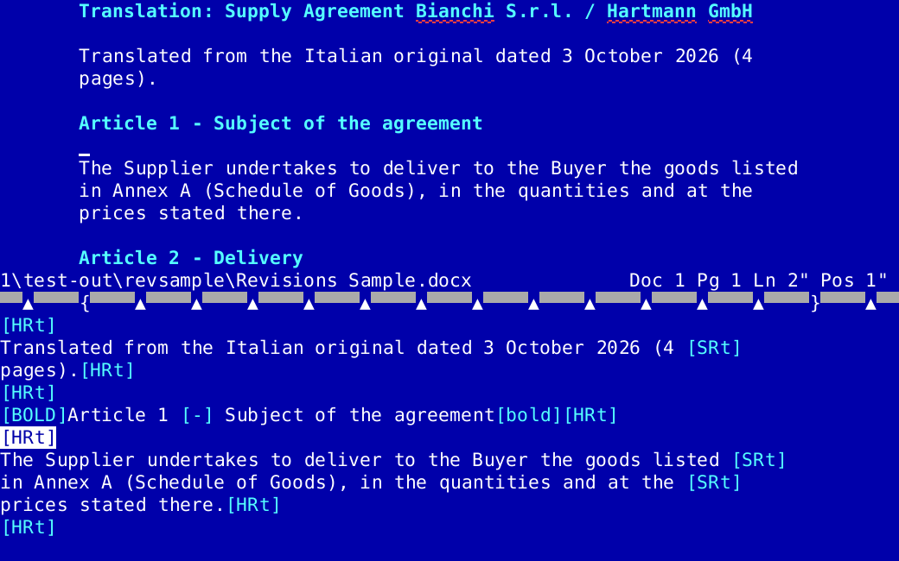
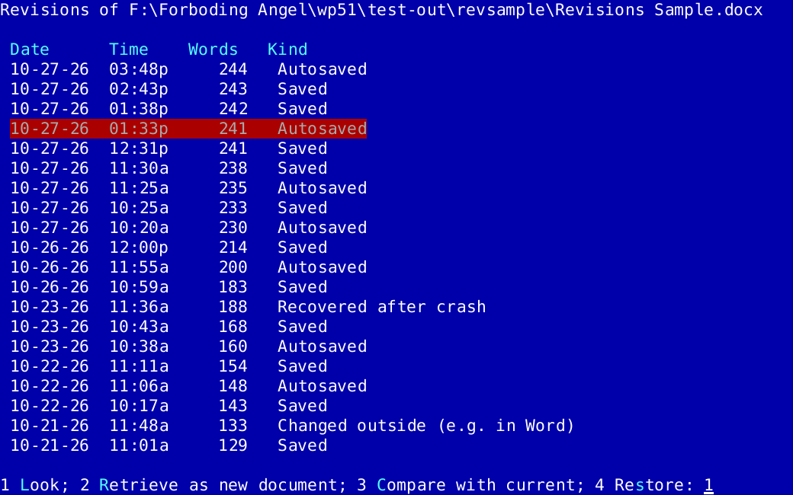

<p align="center"></p>

# Blue Screen Writer 51

**A native Windows word processor that works like WordPerfect 5.1 for DOS — the blue screen, the function keys, the menus and Reveal Codes — with the safety nets and file formats of a modern editor.**

People who wrote with WordPerfect 5.1 for decades often still do, inside DOSBox or vDos, because their hands know every key. Blue Screen Writer 51 lets them keep exactly that way of working, as a real Windows program: no emulator, no 8.3 file names, printing to any Windows printer, and documents that are ordinary Word files.

It is a clean-room re-implementation written from scratch in Rust. It contains no WordPerfect code, and all help texts are its own.



## Download

Get the latest `BlueScreenWriter51-…-windows-x64.zip` from the [Releases](../../releases) page, unzip it anywhere (for example into *Documents*), and double-click `bsw51.exe`. No installation, no administrator rights. Keep the folders `dict`, `thes`, `hyph` and `WPM` next to the program.

Windows 10 and 11 (64-bit).

## What stays the same

If you know 5.1, you already know this program:

- the blue screen, the status line (`Doc 1 Pg 1 Ln 1" Pos 1"`) and the colour scheme, including your own colours from the old setup file;
- every function key and menu: **F11/Alt-F3 Reveal Codes**, Alt-F4 Block, Ctrl-F4 Move, Shift-F8 Format, Alt-F7 Columns/Tables, Alt-F9 Graphics, Ctrl-F9 Merge/Sort, Alt-F5 Mark Text, Shift-F7 Print, F5 List Files, F10/Shift-F10 Save/Retrieve, F7 Exit, …;
- the regular and the **Alternate keyboard** (F1 Help, Esc Cancel, F3 Repeat);
- **macros (.WPM) and keyboard files (.WPK)** — existing ones run unchanged, Ctrl-F10 records new ones and Home, Ctrl-F10 opens the macro editor;
- tables, newspaper and parallel columns, footnotes and endnotes, headers and footers, styles, outline numbering, table of contents, index, cross-references, master documents, merge, sort, math, line numbering, labels, envelopes;
- View Document, the pull-down menu bar (Alt-=), Help with the feature index and keyboard template;
- spell check (Ctrl-F2), thesaurus (Alt-F1) and hyphenation.

## What is new

**Files**
- Documents are saved as **Word documents (.docx)** that open in Word, LibreOffice and on phones. Everything the editor knows (every code you see in Reveal Codes) is kept exactly, even after the file was edited in Word.
- Opens about 25 formats: Word (.docx, .doc, Word for DOS, Word 2), WordPerfect 4.2–6+ (.wp, .wp5, .wpd, …), OpenDocument, RTF, HTML, Markdown, WordStar, Works, Write, Ami Pro, AbiWord, plain text in any encoding, and the text of PDFs.
- Save As Word, **PDF**, ODT, RTF, HTML or text; password-protected documents compatible with Word.
- Long file names with spaces and accents, mapped drives and `\\server\share` paths. Shift-F10 + Up arrow recalls recent documents.
- Can be registered as the Windows program for .docx/.doc/.wpd (Setup → 7).

**Nothing gets lost**
- **Undo/Redo** (Ctrl-Z / Ctrl-Y), many steps, besides the classic Undelete.
- **Crash recovery**: unsaved work is copied every 30 seconds and offered back after a crash or power cut.
- **Automatic saving** of named documents every few minutes.
- **Revision history**: every saved version is kept and can be looked at, retrieved, compared with the current text or restored (Ctrl-F5 → 6) — and it survives the document being edited in Word in between.



**Working with others**
- **Track changes** compatible with Word (Alt-F5 → 7): insertions and deletions are marked, accepted or rejected, and exchanged with Word in both directions. Comments too.
- Copy and paste with the Windows clipboard (Ctrl-Ins, Shift-Del, Shift-Ins).

**Writing**
- **Spell check as you type** with a red underline, with automatic **per-paragraph language detection** (English, German, French, Italian, Spanish, Russian); smart quotes per language; autocorrect.
- Latin and **Cyrillic** text, typed with any Windows keyboard layout or the classic Compose key.
- **Windows printing** with TrueType/OpenType fonts, pictures in PNG/JPEG/BMP/GIF as well as WPG.
- Document information for translators: words, characters, standard lines and pages, invoice amount.
- Large, clear letters that grow with the window; Ctrl + = / Ctrl + Shift + minus / Ctrl + 0 to zoom.
- Optional mouse: click, drag to mark a Block, double-click a word, right-click for the menu bar.

A guide for 5.1 users that explains every new feature is included as `Guide - What Is New.docx` ([source](docs/GUIDE.md)).

## Building from source

Requires Rust (stable) with the `x86_64-pc-windows-gnu` toolchain; it uses the toolchain's own bundled linker, so no Visual Studio or MSYS2 is needed.

```
rustup toolchain install stable-x86_64-pc-windows-gnu
cargo +stable-x86_64-pc-windows-gnu build --release
cargo +stable-x86_64-pc-windows-gnu test
```

The program is `target/release/bsw51.exe`; it finds the dictionaries in `assets/` when run from the repository. `build.rs` embeds the icon (`assets/bsw51.ico`, made by `tools/make_icon.py`) and version information into the executable.

For automated testing the program has a headless mode that plays keys and dumps the screen:

```
bsw51.exe --config TESTDIR some.docx --keys "{Ctrl-F5}\"6\"" --dump screen.txt --png screen.png
```

Developer documentation: [architecture and conventions](docs/ARCHITECTURE.md), [file format notes](docs/formats/), [screen and key specification](docs/spec/), [open items](docs/TODO.md), [plan for right-to-left and CJK scripts](docs/HANDOFF-RTL-CJK.md).

## Releases

Creating a release on GitHub (Releases → Draft a new release, with a new tag such as `v1.0.1`), or pushing such a tag, runs [the release workflow](.github/workflows/release.yml): it runs the tests, builds `bsw51.exe` with that version number, converts the guide to .docx, packages program, dictionaries and licences into a zip and attaches it to the release (creating the release if it does not exist yet). It can also be started by hand from the Actions tab.

```
git tag v1.0.1
git push origin v1.0.1
```

## Licence

The program's source code is released into the public domain ([The Unlicense](LICENSE)).

Bundled third-party data keeps its own licence; the licence texts are in the respective folders:

- spelling dictionaries (`assets/dict`) and hyphenation patterns (`assets/hyph`) from the LibreOffice dictionaries project — GPL / LGPL / MPL / BSD-style depending on the language;
- thesauri (`assets/thes`) — LGPL, and the WordNet licence for English;
- DejaVu Sans Mono font (`assets/fonts`) — Bitstream Vera / DejaVu licence;
- test documents in `tests/data` come from the test suites of open-source document-import projects (LibreOffice, libwpd, libmwaw and others) or were made for this project.

WordPerfect is a trademark of Corel Corporation. This project is not affiliated with or endorsed by Corel; the name is used only to describe compatibility.
